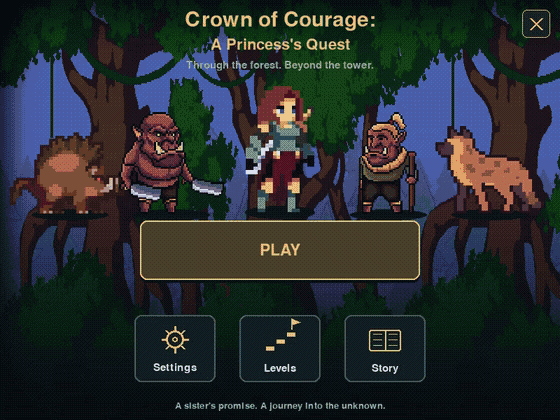
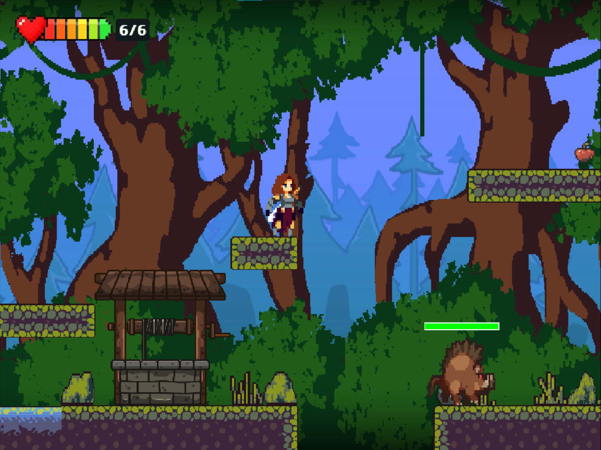
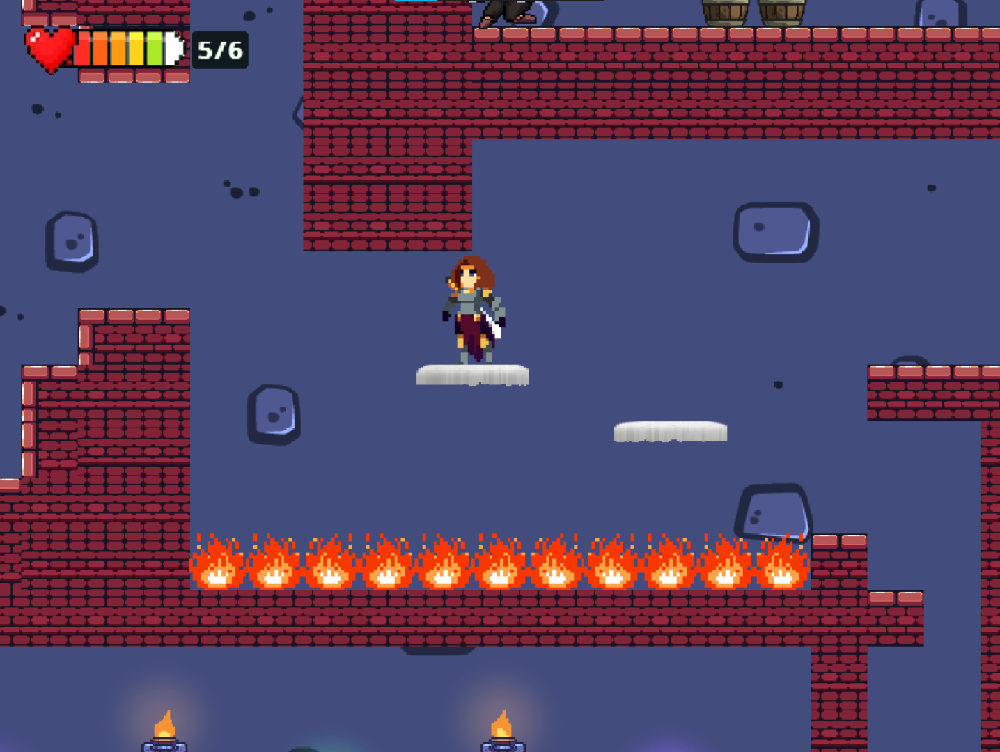

# Crown of Courage: A Princess's Quest

A pixel-art action platformer about a princess searching for her captured brother. Explore a dangerous forest, uncover the secrets of an abandoned tower, and keep moving toward the unknown.

Built with **Python and Pygame**. The initial demo includes two connected scenes.

## Gameplay

[](docs/media/gameplay-montage.mp4)

[Watch the short gameplay montage](docs/media/gameplay-montage.mp4)

| Forest exploration | Inside the tower |
| --- | --- |
|  |  |

## Features

- Exploration, platforming, and environmental puzzles.
- Sword combat, running attacks, and timed critical hits.
- Enemies and a **boss fight**.
- Collectibles, upgrades, inventory, and an illustrated story journal.
- Fullscreen, remappable controls, saved discoveries, and a pause menu.

## Play

Requires **Python 3.10+**.

```bash
python -m pip install -r requirements.txt
python main.py
```

Windows users can also launch through `Run_Game.bat` after installing the requirements.

| Action | Default control |
| --- | --- |
| Move / jump / climb | **A / D**, **W / S** |
| Sprint / grip a box | **Shift** |
| Attack | **Space** |
| Collect / interact / use | **E** |
| Inventory / select item | **Q**, **Left / Right arrows** |
| Dialogue / pause | **Enter**, **Escape** |

For a critical hit, hold through the swing, let the sword connect, then release promptly. Gameplay bindings can be changed in Settings.

## Created together

**[Jensen Jose](https://github.com/ItsJensen316)** and **[Roshan Kumar Patel](https://github.com/doTryCatch)** developed the idea and built the game together, sharing ideas, design decisions, and implementation.

## More

- [Game guide and architecture](docs/GAME_GUIDE.md) — detailed mechanics, physics, progression, and working.
- [Credits](CREDITS.md) — artwork, animation, and sound-effect sources.
